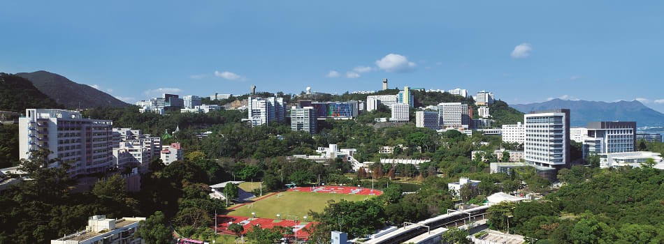

My name is Siyuan Liang, you can also call me Kyrie.

I am currently a postdoctoral research fellow supervised by <a href="https://tsungyiho.github.io">Prof. Tsung-Yi Ho</a>. My study interests include Design Automation, Optimization, Machine Learning, Microfluidics, and Advanced Packaging. You can find more details about me in the corresponding News, Publications, Teaching, and CV pages.

I entered Xi’an Jiaotong University in 2018, majoring in Electrical Engineering and Automation (Elite Class), and was awarded the Yuejie Academic Elite Scholarship (CNY 240,000). In 2022, I received my bachelor’s degree and graduated with honors from the Qian Xuesen Honors College. In 2026, I received my Ph.D. in Computer Engineering from The Chinese University of Hong Kong, with a dissertation entitled “Beyond Trial and Error: Reliable and Efficient Microfluidics via Systematic Design.”

Please feel free to contact me via email, I will do my best to reply promptly.

It's really nice to meet you, wish you a lovely day!

<body>

</body>

