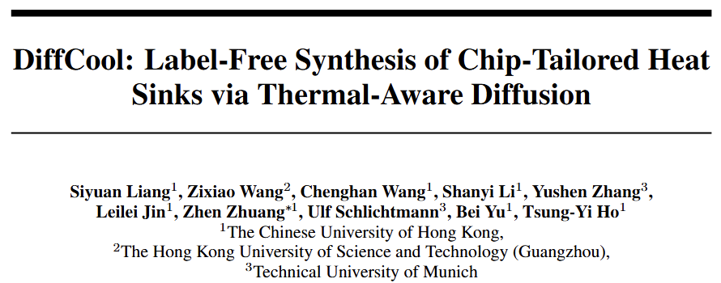

Excited to share that **DiffCool has been accepted at NeurIPS 2026!** This marks our group's first work in **thermal management**, opening a new direction for our research in automated design.

DiffCool generates **customized heat sinks tailored to chip thermal profiles**, while satisfying **manufacturing constraints**. Crucially, it does so **without requiring a labeled dataset**, removing the need for labeled examples that pair chip thermal profiles with heat sink designs.

We are excited to take this first step toward automated, manufacturable cooling solutions for chips. Many thanks to all the co-authors for their contributions and collaboration!

 
